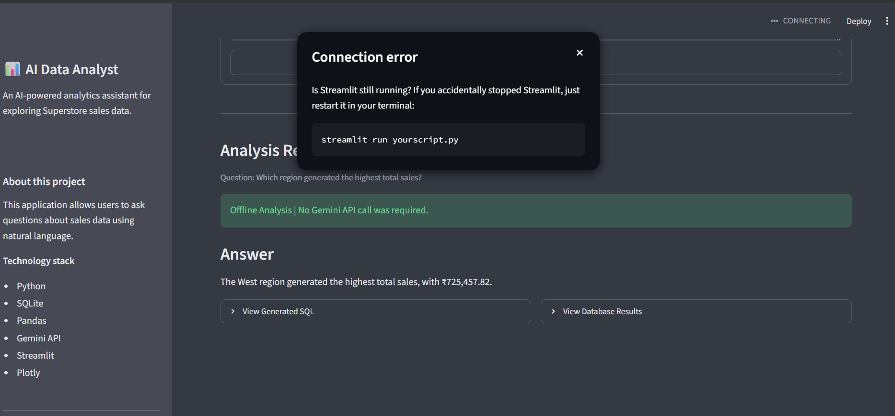
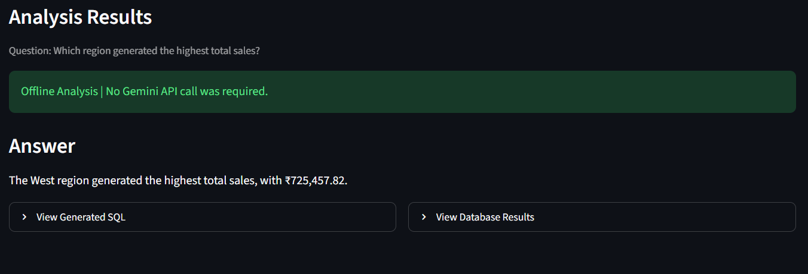
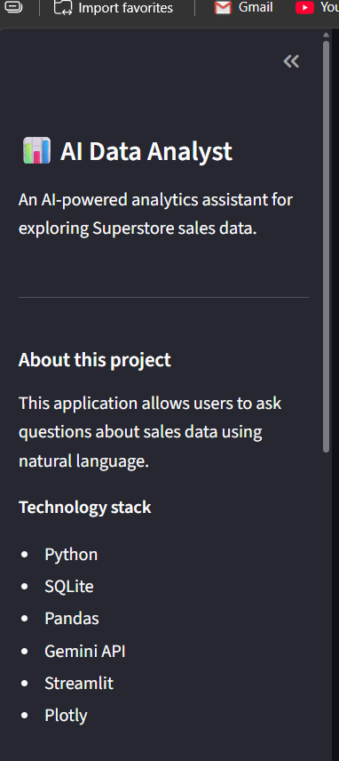

# AI-Assisted Data Analyst

An AI-powered data analysis application that allows users to ask questions about sales data in natural language and receive answers backed by SQL queries and actual database results.

The application combines offline analytics with a Gemini-powered AI agent to translate natural-language questions into SQL, validate queries, execute safe read-only operations, and explain the results in plain English.

## Project Overview

The goal of this project is to demonstrate how an AI agent can help users interact with structured data without requiring them to write SQL manually.

A user can ask questions such as:

- Which region has the highest sales?
- What is the total profit by category?
- Show sales by region.
- What is the average quantity by segment?

The application processes the question, retrieves relevant information from a SQLite database, and presents the results through a Streamlit interface.

## Application Screenshots

### Main Dashboard


### Sales by Region


### Average Quantity by Segment

## Key Features

- Natural-language data analysis.
- Gemini-powered SQL generation.
- Offline analytics for supported questions.
- SQL validation before execution.
- Read-only SQL query execution.
- AI-generated explanations based on query results.
- Automatic Plotly visualizations when the result structure supports charting.
- SQLite database integration.
- Error handling and application logging.
- Unit testing with Pytest.

## Architecture

```text
                  User
                   |
                   v
          Streamlit Application
                   |
                   v
             User Question
                   |
                   v
          Offline Analytics
                   |
          +--------+--------+
          |                 |
      Match Found       No Match
          |                 |
          v                 v
     Predefined SQL     Gemini AI Agent
                            |
                            v
                      SQL Generation
                            |
                            v
                       SQL Validator
                            |
                            v
                    Read-only Execution
                            |
                            v
                    SQLite Database
          |                 |
          +--------+--------+
                   |
                   v
             Query Results
                   |
                   v
           Answer Generation
                   |
                   v
           Streamlit Interface
                   |
             Answer + Chart
```

## Technology Stack

| Category | Technologies |
|---|---|
| Programming Language | Python |
| Data Processing | Pandas |
| Database | SQLite |
| AI / LLM | Google Gemini API |
| AI Integration | Google GenAI SDK |
| Frontend | Streamlit |
| Visualization | Plotly |
| Testing | Pytest |
| Environment Management | Python Virtual Environment |
| Version Control | Git and GitHub |

## Project Structure

```text
AI_Assisted_Data_Analyst/
│
├── app.py
├── requirements.txt
├── .env.example
├── .gitignore
├── README.md
│
├── data/
│   ├── raw/
│   │   └── superstore_sales.csv
│   └── processed/
│       └── superstore_sales_clean.csv
│
├── database/
│   └── superstore.db
│
├── src/
│   ├── agent/
│   │   ├── answer_generator.py
│   │   ├── data_analyst_agent.py
│   │   ├── llm_client.py
│   │   ├── sql_generator.py
│   │   └── sql_validator.py
│   │
│   ├── analytics/
│   │   ├── offline_analytics.py
│   │   ├── query_executor.py
│   │   └── visualization.py
│   │
│   ├── data/
│   │   ├── data_loader.py
│   │   └── verify_processed_data.py
│   │
│   ├── database/
│   │   └── db_manager.py
│   │
│   └── utils/
│       ├── formatters.py
│       └── logger.py
│
└── tests/
    ├── test_answer_generator.py
    ├── test_data_analyst_agent.py
    ├── test_formatters.py
    ├── test_llm_client.py
    ├── test_offline_analytics.py
    ├── test_query_executor.py
    ├── test_sql_generator.py
    ├── test_sql_validator.py
    └── test_visualization.py
```

## How It Works

### 1. Data Processing

- Loads the Superstore CSV dataset using Pandas.
- Converts order dates into datetime values.
- Removes duplicate records.
- Saves the cleaned dataset.

### 2. Database Integration

- Loads the processed CSV into SQLite.
- Creates a `sales` table.
- Makes structured data available for analytical queries.

### 3. Natural-Language Processing

The application accepts questions in natural language.

For supported questions, offline analytics can answer without an LLM API call.

For other questions, the Gemini-powered agent generates an SQL query.

### 4. SQL Validation and Execution

Generated SQL passes through a validation layer before execution.

The application uses read-only query execution to reduce the risk of unwanted database modifications.

### 5. Answer Generation

The application uses query results to generate an understandable response.

If AI answer generation fails, the agent can fall back to returning the database results.

### 6. Visualization

Plotly generates charts automatically when the query result has a supported categorical and numerical structure.

## Dataset

This project currently uses the Sample Superstore sales dataset.

The dataset includes:

- Order Date
- Region
- State
- Category
- Sub-Category
- Segment
- Sales
- Profit
- Quantity

The processed dataset contains 9,992 records.

## Example Questions

Try asking:

1. Which region has the highest sales?
2. Show sales by region.
3. What is the profit by category?
4. Which sub-category has the lowest profit?
5. What is the average quantity by segment?
6. Show total sales and profit.
7. Which segment contributes the highest profit?

The exact questions supported by offline analytics depend on the patterns implemented in the application. Other questions may use the Gemini-powered agent.

## Installation and Setup

### Prerequisites

- Python 3.13 or compatible Python version.
- Git.
- Google Gemini API key for AI-powered analysis.

### Step 1: Clone the repository

```bash
git clone https://github.com/SrijitaJoardar/AI_Assisted_Data_Analyst.git

cd AI_Assisted_Data_Analyst
```

### Step 2: Create a virtual environment

```bash
python -m venv .venv
```

Activate it on Windows PowerShell:

```powershell
.venv\Scripts\Activate.ps1
```

### Step 3: Install dependencies

```bash
python -m pip install -r requirements.txt
```

### Step 4: Configure environment variables

Create a `.env` file in the project root.

Add your Gemini API key:

```env
GEMINI_API_KEY=your_gemini_api_key_here
```

Never commit your actual API key to GitHub.

### Step 5: Prepare the database

Ensure the original dataset exists at:

```text
data/raw/superstore_sales.csv
```

Run the data-cleaning module:

```bash
python -m src.data.data_loader
```

Load the processed data into SQLite:

```bash
python -m src.database.db_manager
```

This creates the SQLite database and loads the `sales` table.

### Step 6: Run the application

```bash
streamlit run app.py
```

Open the local URL displayed in your terminal.

## Running Tests

Run the complete test suite:

```bash
pytest -q
```

The project currently has 63 passing tests.

## Security and Reliability

- SQL queries are validated before execution.
- Database queries use read-only execution.
- Application errors are handled with appropriate fallback behavior.
- Application events are recorded in `logs/app.log`.
- API credentials are stored in environment variables.
- Real credentials must never be committed to the repository.

## Current Limitations

- The current MVP is designed around the Superstore dataset and its predefined schema.
- It does not yet support arbitrary CSV uploads with automatic schema discovery.
- Offline analytics supports a limited set of predefined question patterns.
- Other analytical questions depend on Gemini API availability and quota.
- Automatic visualization is limited to supported result structures.

## Future Improvements

- Support dynamic CSV uploads.
- Automatically infer dataset schemas.
- Build a more flexible RAG-based data analysis workflow.
- Introduce agentic planning and tool execution.
- Support more advanced analytical queries.
- Improve chart recommendations and insight generation.

## Project Status

**MVP completed — Day 10 polishing and portfolio preparation.**

This project was developed incrementally, with individual components tested throughout development.

## Author

Developed as a hands-on project to explore AI-powered data analysis, LLM integration, SQL generation, and agent-based application development.
